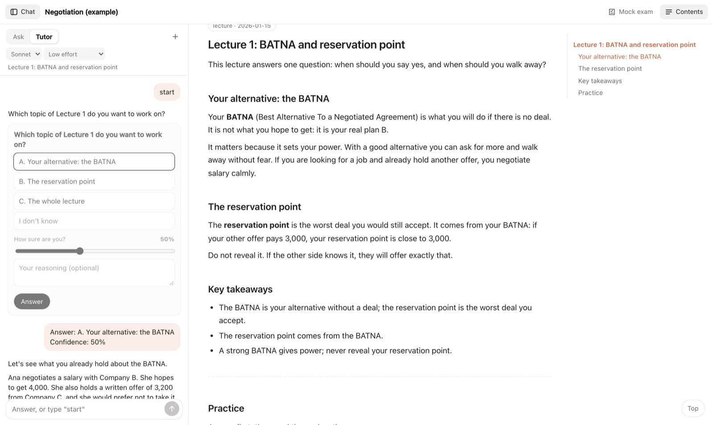

# apuntes

Turn any course into **one study guide** (a single HTML page) and study it with Claude beside you.



- **One guide per course.** An agent per lecture reads the slides, recording, readings and videos and writes the lecture up: concepts explained, slide screenshots, and every study with its question, method, result and what it shows.
- **Practice.** Each lecture ends with multiple choice (explained once you answer) and open questions with a model answer. A separate mock exam mixes every lecture.
- **Claude beside you.** Ask about the lecture you are reading or a selected passage; switch to **Tutor**, which first finds out what you already know, then teaches one step at a time and checks each step with a question where you give your answer, how sure you are and your reasoning; and have your open answers graded. It runs on your Claude subscription through [Claude Code](https://code.claude.com), with the model and effort you pick.

It is an agent skill (Claude Code or Codex): the agent follows `SKILL.md` and runs the scripts. Each part also works on its own.

## Requirements

- Node 20+, Python 3, [pandoc](https://pandoc.org) and poppler (`brew install pandoc poppler`)
- [Claude Code](https://code.claude.com) installed and logged in, for the chat
- macOS for OCR of scanned readings and for keychain credentials; everything else is cross-platform
- Optional: Playwright (installed on first use) to download from Canvas and render PDFs

A lecture's sources can be any PDF (slides, papers, chapters), plain-text transcripts, Granola recordings, or audio transcribed with `transcribe_groq.sh`. Canvas is optional.

## Try the example

```sh
git clone https://github.com/frizynn/apuntes
cd apuntes
python3 scripts/build_html.py example/apunte    # builds example/Negociacion - Guia de estudio.html
node scripts/estudio.mjs example/apunte          # opens http://localhost:4317 with the chat
```

Opened as a plain file, without the server, the guide still works (contents, practice, mock exam), just without the chat.

## Use it for your courses

1. Install the skill: link this folder as `~/.claude/skills/apuntes` (and/or `~/.agents/skills/apuntes`).
2. Create `<Course>/apunte/course.json` from `example/apunte/course.json`: title, guide language, what the exam covers, and one entry per lecture with its sources.
3. Ask your agent: `/apuntes` and "build the guide for <course>" or "add the new lecture". It runs one writer per lecture, checks them, writes the practice and rebuilds the HTML.
4. Study with `node scripts/estudio.mjs "<Course>/apunte" ...` (several courses at once is fine).

## How the chat works

`estudio.mjs` is a dependency-free local server that serves the guides and injects the chat. Each message goes to `claude -p` with the lecture you are reading as context, streamed back as it is written.

- It uses whatever account Claude Code is logged into, and removes `ANTHROPIC_API_KEY` from the environment so it never bills an API key.
- Claude runs with no tools, no MCP servers and none of your `CLAUDE.md` files: it only sees the text the server sends.
- It listens on `127.0.0.1` only and requires a token that is embedded in the page it serves, so other websites cannot use your account.
- Model (Haiku, Sonnet, Opus) and effort are picked in the chat; `ESTUDIO_MODEL` sets the default, `PORT` the port.

## Layout

```
SKILL.md                  steps the agent follows
references/               briefs for the lecture writers and the practice writers
scripts/
  canvas_sync.mjs         optional: download pages and files from Canvas
  prepare_lecture.py      prepare a lecture's slides, readings (with OCR) and quiz
  check.sh                style checks for a written lecture
  check_practice.py       validate practice questions
  build_html.py           build the guide: contents, practice, mock exam
  estudio.mjs             local server with the Claude chat
  estudio_panel.js        the chat (Ask, Tutor, grading)
  assemble.py, render_pdf.mjs, export_docx.py   PDF or docx output
  transcribe_groq.sh      transcribe lecture audio (Groq Whisper)
example/apunte/           a small example course
```

Course material (slides, readings, recordings) belongs to you or your university and never goes in this repo: `.gitignore` excludes `sources/`, `img/` and `reports/`.

The chat design follows ideas from [Fluid Functionalism](https://www.fluidfunctionalism.com) (MIT), and the tutor's probe, plan, teach and check loop is inspired by [LearnHarness](https://github.com/amosblomqvist/learnharness).

## License

MIT
